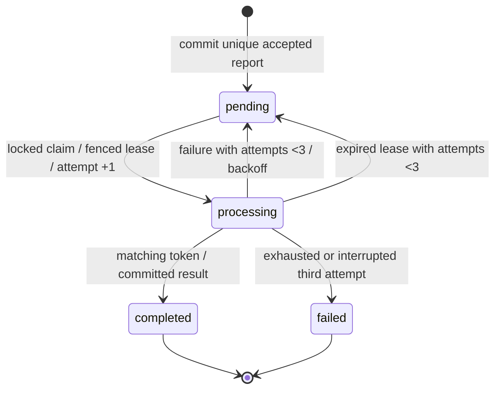

# Architecture

API commits report before acceptance. PostgreSQL is authoritative; pending rows form a durable outbox. Dispatch is best effort after commit and reconciled periodically. Redis provides at-least-once delivery; a database lease and fenced attempt token make duplicate delivery safe. Scheduler recovers expired leases, dispatches due pending reports and finalizes immutable deadline outcomes. Simulator bounds delays and deterministic failures by attempt number.

API/worker/scheduler share one application image. A singleton exporter reads durable metric aggregates from PostgreSQL; workers/API update them transactionally. Prometheus scrapes the exporter once: do not scrape the same shared counters through every replica. IDs belong in structured logs, never metric labels. Terraform owns namespace and all deployment resources; kind owns cluster/node only.

State and metrics outcomes commit together. Redis notifications are replaceable; report data isn't. The report row is the outbox and the unique result storage. Reconciler materializes deadline outcomes independently of successful completion. Fencing protects against a delayed old attempt after a newer worker takes over. A real mutating dependency would need downstream idempotency; this simulator is deterministic/pure.

Terraform owns resource manifests after kind bootstrap. Transient smoke/load/fault commands operate on existing lab resources; they never deploy to another context. Code checksums force rollout before migrations; configuration checksums refresh observability pods. No manual restart annotations are introduced by the final deploy command. Preserved local PostgreSQL storage differs from ephemeral Redis/observability data. The CLI HTTP server and single-node database/cluster explicitly limit conclusions.
