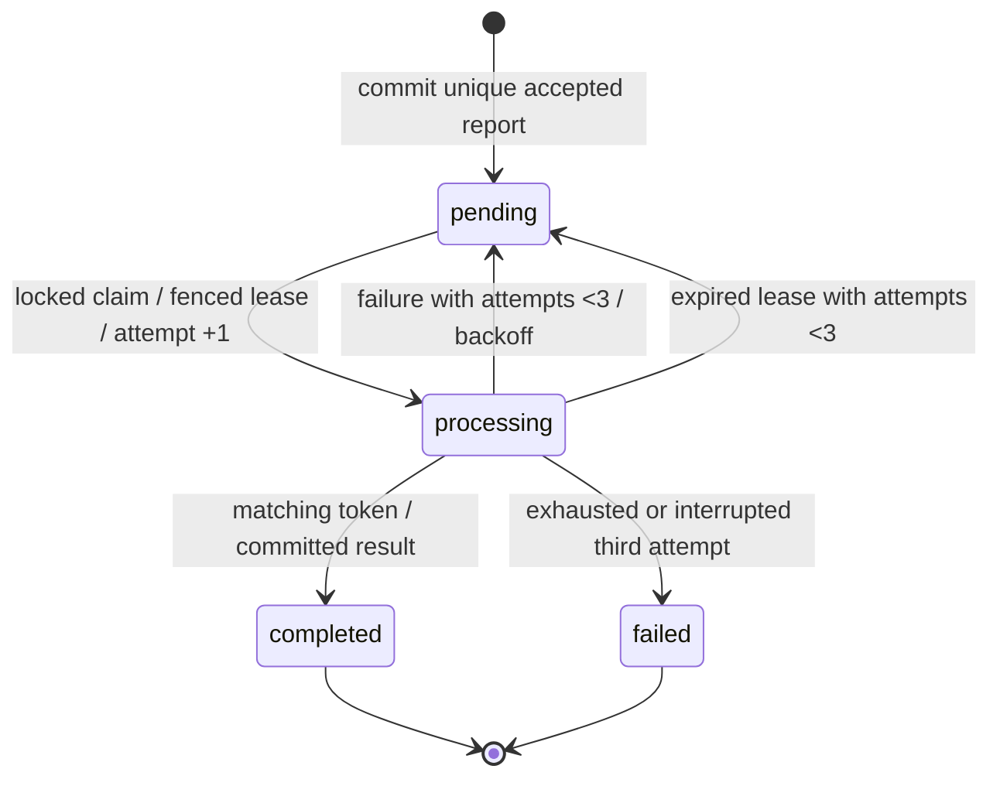

# Architecture

API commits report before acceptance. PostgreSQL is authoritative; pending rows form a durable outbox. Dispatch is best effort after commit and reconciled periodically. Redis provides at-least-once delivery; a database lease and fenced attempt token make duplicate delivery safe. Scheduler recovers expired leases, dispatches due pending reports and finalizes immutable deadline outcomes. Simulator bounds delays and deterministic failures by attempt number.

API/worker/scheduler share one application image. A singleton exporter reads durable metric aggregates from PostgreSQL; workers/API update them transactionally. Prometheus scrapes the exporter once: do not scrape the same shared counters through every replica. IDs belong in structured logs, never metric labels. Terraform owns namespace and all deployment resources; kind owns cluster/node only.

State and metrics outcomes commit together. Redis notifications are replaceable; report data isn't. The report row is the outbox and the unique result storage. Reconciler materializes deadline outcomes independently of successful completion. Fencing protects against a delayed old attempt after a newer worker takes over. A real mutating dependency would need downstream idempotency; this simulator is deterministic/pure.

Terraform owns resource manifests after kind bootstrap. Transient smoke/load/fault commands operate on existing lab resources; they never deploy to another context. Code checksums force rollout before migrations; configuration checksums refresh observability pods. No manual restart annotations are introduced by the final deploy command. In the historical G1 runtime, PostgreSQL was retained while Redis/observability were ephemeral, and the CLI HTTP server limited capacity interpretation. G2 changes runtime/telemetry retention below; Redis remains replaceable and the database/cluster remain single-node.

## G2 runtime and persistence

NGINX/PHP-FPM replaces the G1 development HTTP server. An internal gateway opens independent connections through the API ClusterIP; both ready replicas are verified with serving-pod response headers. PostgreSQL still owns durable business/metric state; no queue semantics changed. Six single-writer Recreate deployments mount retained local telemetry PVCs backed by a project-only kind host bind mount. G2 backup restoration uses a new isolated logical database, never overwrites live PostgreSQL. See ADRs009/010 and docs/g2/ for measured limits and commands.

G2 measured 30 requests/s for ten minutes with all 18,000 accepted reports on time. The failed 60 requests/s step revealed probe timeouts/restarts and generator delay; it is not a precise server-only ceiling. Review docs/g2/capacity.md and recovery-report.md. A subsequent Cloudflare Tunnel access request is separately authorized and pending account/hostname inputs; it does not change the internal benchmark path.
