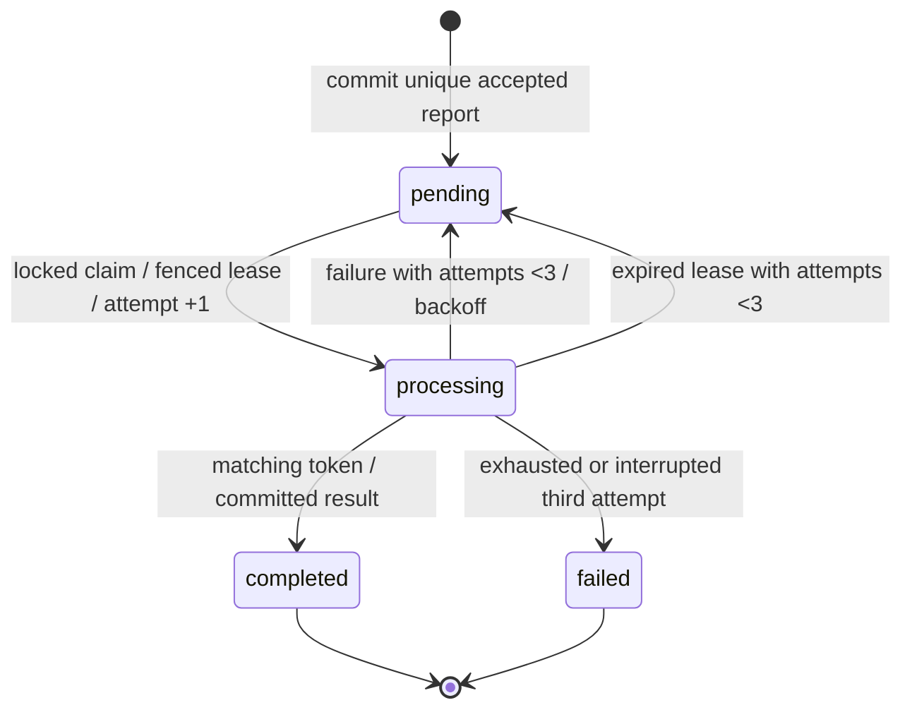

# Architecture

API commits report before acceptance. PostgreSQL is authoritative; pending rows form a durable outbox. Dispatch is best effort after commit and reconciled periodically. Redis provides at-least-once delivery; a database lease and fenced attempt token make duplicate delivery safe. Scheduler recovers expired leases, dispatches due pending reports and finalizes immutable deadline outcomes. Simulator bounds delays and deterministic failures by attempt number.

API/worker/scheduler share one application image. A singleton exporter reads durable metric aggregates from PostgreSQL; workers/API update them transactionally. Prometheus scrapes the exporter once: do not scrape the same shared counters through every replica. IDs belong in structured logs, never metric labels. Terraform owns namespace and all deployment resources; kind owns cluster/node only.

State and metrics outcomes commit together. Redis notifications are replaceable; report data isn't. The report row is the outbox and the unique result storage. Reconciler materializes deadline outcomes independently of successful completion. Fencing protects against a delayed old attempt after a newer worker takes over. A real mutating dependency would need downstream idempotency; this simulator is deterministic/pure.

Terraform owns resource manifests after kind bootstrap. Transient smoke/load/fault commands operate on existing lab resources; they never deploy to another context. Code checksums force rollout before migrations; configuration checksums refresh observability pods. No manual restart annotations are introduced by the final deploy command. In the historical G1 runtime, PostgreSQL was retained while Redis/observability were ephemeral, and the CLI HTTP server limited capacity interpretation. G2 changes runtime/telemetry retention below; Redis remains replaceable and the database/cluster remain single-node.

## G2 runtime and persistence

NGINX/PHP-FPM replaces the G1 development HTTP server. An internal gateway opens independent connections through the API ClusterIP; both ready replicas are verified with serving-pod response headers. PostgreSQL still owns durable business/metric state; no queue semantics changed. Six single-writer Recreate deployments mount retained local telemetry PVCs backed by a project-only kind host bind mount. G2 backup restoration uses a new isolated logical database, never overwrites live PostgreSQL. See ADRs009/010 and docs/g2/ for measured limits and commands.

G2 measured 30 requests/s for ten minutes with all 18,000 accepted reports on time. The failed 60 requests/s step revealed probe timeouts/restarts and generator delay; it is not a precise server-only ceiling. Review docs/g2/capacity.md and recovery-report.md. The separately authorized Cloudflare Tunnel exposes authenticated Grafana behind Access; it does not change the internal benchmark path. Sanitized connection/browser evidence is under evidence/cloudflare/.

## G3 independent probes and bounded measurements

NGINX separates application port 8080 from internal diagnostics port 8082. API/exporter process startup/liveness use the independent FPM status pool, while NGINX checks its own response. Application readiness still checks dependencies through the main pool. The Kubernetes readiness request has a three-second timeout; the FPM request termination bound remains 15 seconds, so client/probe timeout and server work termination are distinct. Native liveness does not establish useful main-pool or queue progress.

Terraform owns a headless api-diagnostics Service. DNS discovery collects both native API pool metrics independently, including unready pods; shared application/worker outcome counters retain one singleton PostgreSQL exporter. PostgreSQL statistics expose bounded operation/wait categories without raw queries, and Redis queue depth complements durable pending/processing gauges. Counters that restart with a native process must be rated before aggregation.

Histogram updates use one atomic sorted multi-row increment statement, preserving the existing transaction and cumulative-bucket semantics. No schema, admission limit, extra children, CPU increase, dependency upgrade or new tracing stack was introduced. See ADRs [011](decisions/011-independent-fpm-probes.md) and [012](decisions/012-batched-durable-histograms.md), [the overload runbook](runbooks/overload.md) and [G3 validation](g3/validation.md). Capacity remains a measured local outcome with generator/data/warm-up limitations.

## G4 transport guard and native recovery

PostgreSQL acceptance/leases/results remain unchanged. A narrow publication extension of the pinned Laravel RedisQueue atomically enqueues a ProcessReport payload/wake-up entry and owner guard. Native consumption/reserved expiry remains in use. A committed SQL claim/no-op releases only that notification's owner; pre-handle native failure also cleans up only its matching guard. Native transport failure is logged/counted separately from bounded SQL business attempts.

The guard has a twenty-four-hour safety TTL and lives in the same Redis database as its payload; it is replaceable transport metadata. No independent cache lock is acquired before enqueue. Whole transport loss is recovered from SQL pending rows, while selective corruption or waiting beyond the TTL remains a documented limit. See [ADR 013](decisions/013-atomic-report-notifications.md), [failure-window matrix](g4/queue-protocol.md) and [operator runbook](runbooks/queue-notifications.md). The default stack remains standalone Redis and single-node Kubernetes, with the same versions/resource limits and no new public endpoint.
