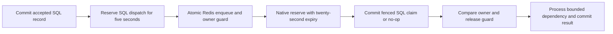

# Report notification protocol and failure windows

PostgreSQL is the durable acceptance and result authority. Redis holds replaceable transport state: native ready/reserved/delayed payloads, wake-up notifications and a per-report owner guard. The five-second SQL reservation limits dispatch competition; the Redis guard prevents repeated waiting payloads while that reservation expires. Neither proves useful progress or changes immutable processing deadlines.

| Interruption or error | Durable/transport state | Recovery and limit |
| --- | --- | --- |
| Before SQL acceptance commits | No accepted record | Client may submit again; never acknowledge uncommitted acceptance |
| After acceptance, before Redis operation | SQL pending; no new guard/payload | Reconcile after five-second dispatch reservation |
| Redis operation completes, response lost | Guard and payload coexist; SQL pending | Repeated dispatch suppresses; same idempotency key recovers acknowledgement |
| Predictable script key-type error | No writes by the validated publication branch | Error counter/log, pending record retried; correct only owned test state in tests |
| Worker disappears after reserve, before handle | SQL pending/zero business attempts; native reservation and guard remain | After twenty-second native reservation expiry, exhausted delivery fails before handle; matching guard cleanup permits reconciliation/new notification |
| SQL claim commits, worker disappears before releasing guard | Processing lease plus old guard/reservation | Lease recovery and native failure cleanup restore pending delivery; no promise of exact timing across all outages |
| Worker disappears after guard release/during dependency | SQL processing; no waiting guard from that delivery | Existing fifteen-second lease/fenced recovery; old delivery cannot clear a newer owner |
| Old notification arrives after newer publication | New guard owner and native payload exist | Old token cannot clear new guard; SQL fencing/terminal checks prevent duplicate result |
| Whole queue/guard state is lost | SQL accepted state survives | Pending rows republish; processing lease resolves first. Tested only with owned isolated test state, not a live flush |
| Selective corruption leaves a guard without its payload | SQL pending, orphaned transport guard possible | Not covered by whole-state-loss guarantee; guard has a twenty-four-hour safety expiry. Investigate without deleting live state blindly |
| No worker consumes for longer than guard TTL | Pending acceptance may already miss deadline; guard expires | A later publication may duplicate an old payload. This is bounded deduplication lifetime, not exactly-once transport or monthly timeliness |

Redis Lua execution is isolated from concurrent commands but does not roll back writes on script runtime errors. The script checks predictable list-type errors before mutation; abrupt failure/persistence/corruption scenarios beyond this local contract remain limitations. Native unique-job locks would introduce a separate acquire-before-enqueue gap; publication therefore uses the pinned RedisQueue extension rather than a standalone cache lock.

Transport attempts and business attempts are different. Native max-attempt rejection before handle does not consume a SQL business attempt or mark the report terminal; it is logged/counted and reconciled. Third exhausted business/lease attempt remains failed and visible. Completed/failed records are never converted back to pending to make an experiment pass. A late completion leaves its missed deadline intact.

The lab supports one standalone Redis instance. This publication extension does not add Redis Cluster support, arbitrary bulk/delayed deduplication or an external administrative endpoint. Current submission/reconcile uses ordinary ProcessReport push; native consumption/reservation remains unchanged. Legacy payloads without metadata still work. Rollout occurs after the project queue drains; no database migration, CPU increase or report reset is needed.
